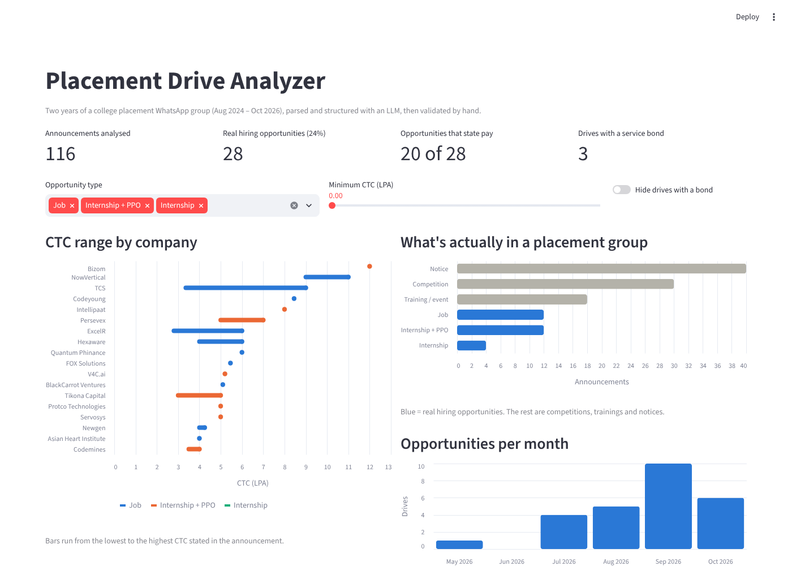

# Placement Drive Analyzer

Turns two years of a college placement WhatsApp group into a clean, queryable dataset of hiring drives — using an LLM for extraction and a validation layer to catch its mistakes.



## The problem

Every placement announcement (company, role, CTC, stipend, bond, eligibility, deadline) lives in one WhatsApp group, mixed in with reminders, webinars, hackathons and "ok sir" replies. After two years it is impossible to answer simple questions like *which drives paid the most?* or *how many came with a bond?*

## What it does

```
chat.txt ──► parse_chat.py ──► announcements.csv ──► extract.py (Gemini) ──► extracted.csv
 (1,578 messages)   regex parse,         120 anonymised            LLM → JSON fields
                    filter, anonymise    announcements
                                                                         │
            app.py ◄── placements.db ◄── build_db.py ◄── clean.csv ◄── validate.py + clean.py
          (Streamlit)    (SQLite)                       (12 logged fixes  (auto check + manual
                         queries.sql                     + 1 rule)          review)
```

| Step | Script | What happens |
|---|---|---|
| 1. Parse | `parse_chat.py` | Regex detects where each message starts, merges multi-line messages, gives each message a permanent `msg_id` |
| 2. Filter + anonymise | `parse_chat.py` | Keeps long messages with hiring keywords; drops results and name lists; masks phone numbers, emails and group links |
| 3. Extract | `extract.py` | Gemini (`gemini-flash-lite-latest`) returns company, type, CTC, fixed pay, stipend, bond, branches, criteria, location, deadline as JSON. Retries on errors, saves after every message, resumes where it stopped |
| 4. Validate | `validate.py`, `review.py` | Checks every extracted number actually appears in the source message; every opportunity row reviewed by hand |
| 5. Correct | `clean.py` | All fixes written as code with a reason — the raw AI output is never edited |
| 6. Store + query | `build_db.py`, `queries.sql`, `run_queries.py` | SQLite tables `announcements` and `companies`; 8 analysis queries (GROUP BY, CASE, JOIN, date functions) |
| 7. Dashboard | `app.py` | Streamlit: KPIs, filters, CTC ranges, post mix, monthly trend, searchable table |

**Stack:** Python · pandas · regex · Google Gemini API · SQLite / SQL · Streamlit + Altair

## Findings

- **Only 24% of "placement" posts are real hiring opportunities** — 28 of 116. The rest are notices (40), competitions/hackathons (30) and trainings or events (18).
- **Pay is often missing:** 8 of the 28 opportunities state neither a CTC nor a stipend.
- **Median top-of-range CTC is 5.7 LPA** across the 18 jobs / internship+PPO drives that state one; the range runs from 4 LPA to 12 LPA (Bizom).
- **Headline CTC hides variable pay.** Intellipaat's 8 LPA is only 53% fixed (4.2 LPA); BlackCarrot's 5.1 LPA is 71% fixed.
- **Bonds are rare but real:** 3 drives require one (Hexaware 3 years, NowVertical and FOX Solutions 2 years). 20 of 24 drives don't mention a bond at all.
- **Offers can change after the announcement:** NowVertical announced 9–11 LPA, then revised it to 8 LPA (9–11 only for exceptional candidates) when sharing the shortlist.
- **The season is concentrated:** 25 of the 28 opportunities arrived between July and October 2026, peaking at 10 in September.
- **Internship + PPO is now as common as direct jobs** (12 each), with stipends from ₹10,000 to ₹40,000 a month.

## Validating the LLM

The LLM was right most of the time, but not all of the time — and the errors were the kind that silently break an analysis.

| Error the LLM made | How it was caught | Fix |
|---|---|---|
| Stipends written in lakhs instead of rupees (₹30K → `0.3`) in 3 rows | `validate.py`: number not found in the source text | Prompt rule: "stipend is in rupees per month, never lakhs" → 0 unit errors on the rerun |
| Same message, different answers across runs (Intellipaat stipend `25000`, then `0.025`) | Comparing runs | Validation runs on every extraction, not once |
| Invented "no bond" (`0`) for 9 messages that never mention a bond | Manual review, then a rule in `clean.py` | `bond_years = 0` kept only if the message mentions a bond |
| Picked the wrong track in multi-track offers (Dr. Reddy's: ₹75,000 Mechanical track instead of ₹40,000 Digital & AI) | Manual review | Logged correction |
| Prize internships labelled as internships (Tata Crucible, Nykaa creator campaign) | Manual review | New `competition` type + prompt rule; logged corrections |
| Returned a list of 18 objects for a message listing many companies | Script crash | Prompt rule + code safety net |
| Reposts counted as new drives | Manual review | Marked `duplicate` |

The validation script itself had a bug: its "lakh" conversion let `0.2` pass as `20000`. Version 1 caught 1 of the 3 unit errors; after the fix it caught all 3.

## Privacy

- The raw chat (`chat.txt`) and anything containing message text (`announcements.csv`, `review.csv`) are git-ignored and never published.
- Phone numbers, emails and WhatsApp group links are masked before the text reaches the LLM.
- Result messages, shortlists and anything with roll numbers, Superset IDs, passwords or passcodes are dropped entirely.
- Published files (`clean.csv`, `placements.db`) contain only extracted company-level fields.

## Limitations

- Drives shared only as a PDF or image (e.g. CarWale) have no details in the chat export.
- An early version of the filter dropped real drives (Newgen, V4C.ai) because their text mentioned a "shortlist". The fix: drop shortlist messages only when they don't mention pay, and give every message a permanent ID so re-filtering never breaks the links between files.
- One group, one batch: the numbers describe this college's 2027 season, not the market.

## Run it yourself

```bash
pip install -r requirements.txt
# put your WhatsApp export in chat.txt and GEMINI_API_KEY=... in .env
python parse_chat.py      # 1-2: parse, filter, anonymise
python extract.py         # 3: LLM extraction (~15 min on the free tier)
python validate.py        # 4: automatic number check
python clean.py           # 5: apply logged corrections
python build_db.py        # 6: build placements.db
python run_queries.py     #    run the SQL analysis
streamlit run app.py      # 7: dashboard
```

`placements.db` is included, so `streamlit run app.py` works straight after cloning.
